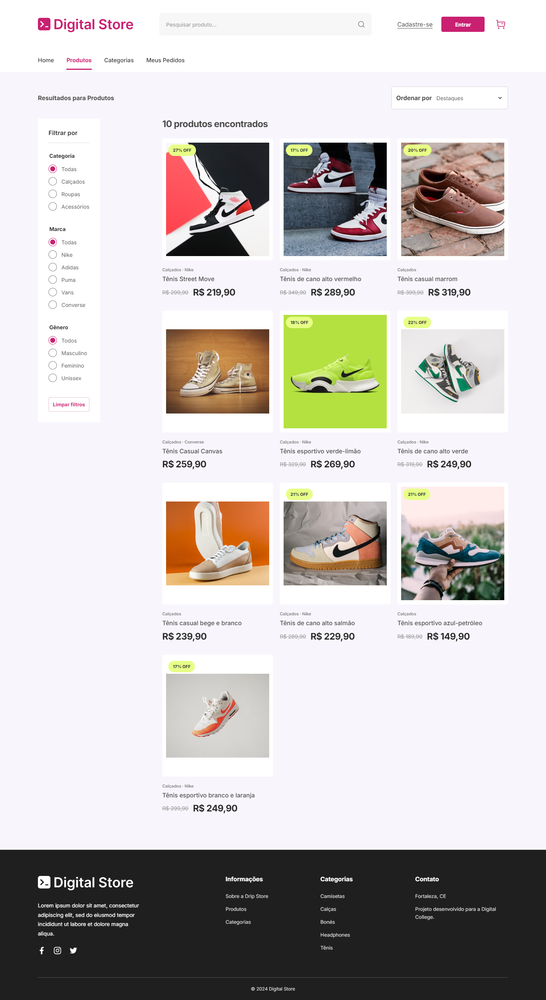
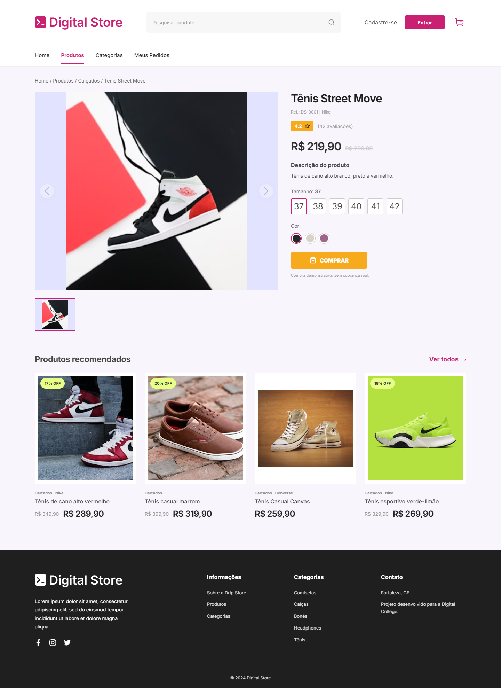

> **Entrega acadêmica:** implementação React desenvolvida a partir do enunciado da Digital College. Este arquivo documenta a aplicação; o README original do professor foi preservado.

# Digital Store — Front-end

Projeto de Front-end da Digital College, desenvolvido por Edson Monteiro.

A ideia foi montar as três páginas de uma loja virtual: início, catálogo e detalhes de um produto. Usei React e mantive os dados em um arquivo local para trabalhar primeiro a navegação, os componentes e o layout.

**[Abrir a loja](https://digital-store-frontend-iota.vercel.app)** | [Enunciado da atividade](https://github.com/digitalcollegebr/projeto-digital-store) | [Back-end do projeto](https://github.com/Edsmonteiro/digital-store-backend)

## O que dá para fazer

Na **Home**, há um carrossel, três coleções e oito produtos em destaque. No **catálogo**, é possível pesquisar, filtrar por categoria, marca ou gênero e ordenar por preço. Na página do **produto**, dá para trocar as imagens, selecionar cor e tamanho e adicionar o item ao carrinho.

Também deixei um fluxo simples de pedidos para testar a navegação. Ele funciona apenas no navegador: não existe login, pagamento ou compra real.

## Telas

| Home | Catálogo | Produto |
|---|---|---|
|  |  |  |

## Tecnologias

React 18, JavaScript, Vite, React Router DOM, CSS e Lucide React.

Organizei a aplicação em `src/components` (partes reutilizáveis), `src/pages` (telas), `src/data` (produtos de exemplo), `src/lib` (busca e filtros) e `src/context` (carrinho).

## Rodar no computador

Com Node.js 20 ou superior instalado:

```bash
npm ci
npm run dev
```

Para verificar o projeto:

```bash
npm run build
npm test
npm run test:e2e
```

Os testes de navegador usam Playwright: Edge no Windows e Chromium no GitHub Actions. Eles passam pelas três páginas e verificam busca, filtros, galeria, carrinho, imagens e tamanhos de tela de 375 a 1440 px.

## O que ficou fora do escopo

Este repositório é a parte visual do trabalho. O catálogo é demonstrativo. Os dez itens demonstrativos usam fotos oficiais distintas e descrições coerentes com o que aparece em cada foto. Cada item tem uma única foto confirmada. Camisetas, calças, bonés e headphones abrem suas categorias e mostram um estado sem estoque. A coleção Adidas também informa a indisponibilidade, pois nenhum calçado fotografado foi identificado como Adidas. Tênis abre os calçados disponíveis. Os recursos oficiais estão em `public/store`. O [Back-end](https://github.com/Edsmonteiro/digital-store-backend) foi feito em um projeto separado e ainda não alimenta esta loja.

As capturas anexadas do Figma orientaram a revisão do banner, das grades e dos estados mobile. As comparações têm como referência imagens rasterizadas e não confirmam medidas e pesos tipográficos exatos. Os ícones de categoria são aproximações, e o rodapé não reproduz os dados de contato que não puderam ser confirmados. O banner mantém o recorte do tênis branco e vermelho na primeira posição e usa o recorte transparente de `home-slide-4.jpeg` na segunda. A imagem azul de `home-slide-2.jpeg` foi descartada após revisão visual, pois o enquadramento não funcionou bem no banner. Nenhum slide exibe o fundo retangular de uma fotografia. A foto do K-Swiss e as cinco vistas do produto da referência não foram localizadas como arquivos independentes. As capturas responsivas dos testes ficam em `test-results/visual`.

**Referências:** [requisitos oficiais](https://github.com/digitalcollegebr/projeto-digital-store) · [design no Figma](https://www.figma.com/design/nUk0ihM3x4u8JQtxUoAEJf/DRIP-STORE---DIGITAL-COLLEGE--Copy-?node-id=22-30&p=f)

Prazo da atividade: 20/11/2026.

**Crédito do banner:** recorte `White-Sneakers-PNG-Clipart.png`, de [PNG All](https://www.pngall.com/sneakers-png/), usado como recurso visual no exercício acadêmico sem finalidade comercial.

**Origem do segundo slide:** arquivo `home-slide-4.jpeg` do [repositório oficial da Digital College](https://github.com/digitalcollegebr/projeto-digital-store/tree/main/public), recortado e convertido para PNG transparente.


**Nota sobre as imagens:** a captura da Home é carregada diretamente do [repositório da aplicação](https://github.com/Edsmonteiro/digital-store-frontend), enquanto as outras duas capturas estão incluídas nesta branch. O enunciado original permanece no `README.md` do fork.
